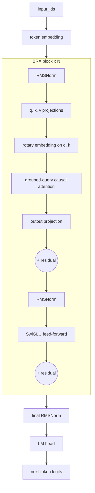
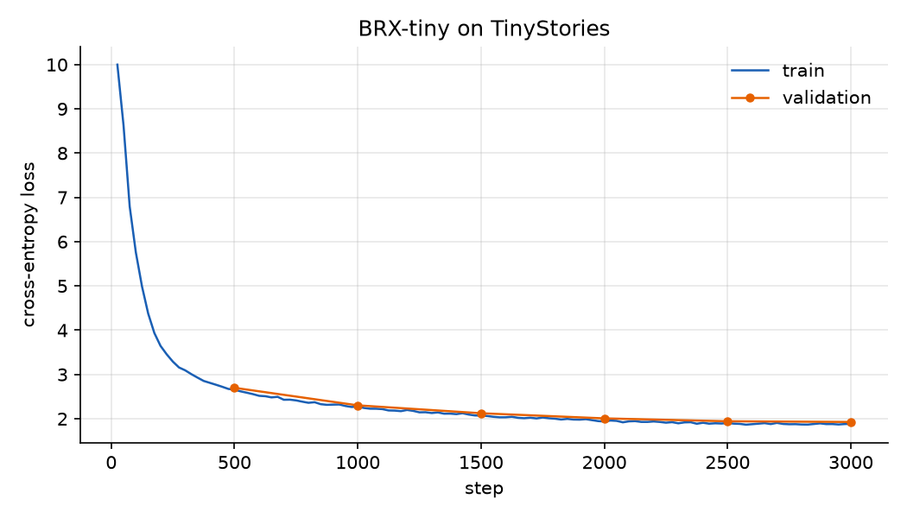

# BRX

A LLaMA-style, decoder-only language model written from scratch in PyTorch.

BRX implements the pieces that modern open LLMs are built from (rotary position embeddings, grouped-query
attention, RMSNorm and a SwiGLU feed-forward block) without using any model code from Hugging Face. It still
plugs into the Hugging Face ecosystem as a `PreTrainedModel`, so it trains with `Trainer`, saves with
`save_pretrained` and loads with `AutoModelForCausalLM`.


## Architecture



| Component | What it does | Code |
|---|---|---|
| **Rotary embeddings** (RoPE) | Rotates each query/key pair by an angle proportional to its position, so attention scores depend on the *relative* distance between tokens. | [`layers.py`](brx/layers.py) |
| **Grouped-query attention** | Several query heads share one key/value head, which shrinks the KV projections (and the KV cache at inference) with little quality loss. 16 query heads share 2 KV heads in the base config. | [`model.py`](brx/model.py) |
| **RMSNorm** | Pre-norm before attention and before the feed-forward block. It is cheaper than LayerNorm because it doesn't subtract the mean. | [`layers.py`](brx/layers.py) |
| **SwiGLU** | A gated feed-forward block, `down(silu(gate(x)) * up(x))`, as used in LLaMA and PaLM. | [`layers.py`](brx/layers.py) |
| **Causal LM head** | Shifted next-token cross-entropy, with optional input/output embedding tying. | [`model.py`](brx/model.py) |

## Configurations

| Config | Layers | Hidden | Heads (q / kv) | Context | Parameters (non-embedding) | Data |
|---|---|---|---|---|---|---|
| [`brx-tiny`](configs/brx-tiny.yaml) | 6 | 256 | 8 / 2 | 256 | 12.7M (4.5M) | TinyStories |
| [`brx-base`](configs/brx-base.yaml) | 6 | 1024 | 16 / 2 | 1024 | 117M (52M) | CodeParrot (Python) |

Both use the Llama BPE tokenizer (32k vocabulary). `brx-tiny` ties its input and output embeddings, because
at this size the embedding matrix would otherwise be most of the model.

## Results

`brx-tiny` trained for 3,000 steps (about 24.6M tokens, half an epoch over the first 200k TinyStories stories)
in 32 minutes on an Apple Silicon laptop GPU.

| | |
|---|---|
| Validation loss | **1.93** (perplexity 6.9) |
| Train loss at step 25 | 10.0 (a uniform guess over 32k tokens scores ln 32000 ≈ 10.4) |
| Throughput | 1.56 steps/s, batch 32 × 256 tokens |



Samples (prompt in bold, `--temperature 0.8 --top-k 50`):

> **Once upon a time**, there was a little girl named Lily. She loved to play outside in the sun. One day, she
> saw a big snowman on the ground. She was very excited to go feed him.

> **Once upon a time**, there was a little girl named Molly. She was 3 years old and loved to explore.
> One day, she decided to go on a journey to get into a big mountain. [...] When she arrived at the mountain,
> she saw a beautiful mountain with bright blue grass. It was very bright and sparkly.

The grammar and story structure are right. The logic still wanders (feeding a snowman, blue grass), which is
expected from a 4.5M non-embedding-parameter model after half an hour of training.

## Quickstart

```bash
git clone https://github.com/brijeshsankhavara/brx-llm.git
cd brx-llm
pip install -e ".[dev]"

# run the tests (CPU, a few seconds)
pytest

# pretrain the tiny model (Apple Silicon GPU, CUDA or CPU)
python -m brx.train --config configs/brx-tiny.yaml

# sample from it
python -m brx.generate --model runs/brx-tiny --prompt "Once upon a time" --temperature 0.8 --top-k 50

# plot the loss curve
python scripts/plot_loss.py runs/brx-tiny/log_history.json assets/loss.png
```

To train on your own data, copy a config and change the `data` section. Any Hugging Face dataset with a text
column works. Documents are streamed, tokenized, joined with an EOS token and packed into full-length
blocks, so no compute is wasted on padding.

Using it from Python:

```python
import torch
from brx import BRXConfig, BRXForCausalLM
from brx.generate import generate

model = BRXForCausalLM(BRXConfig(hidden_size=256, num_hidden_layers=4, num_attention_heads=8, num_key_value_heads=2))
input_ids = torch.tensor([[1, 415, 2501]])
out = model(input_ids, labels=input_ids)  # out.loss, out.logits
tokens = generate(model, input_ids, max_new_tokens=20, top_k=50)
```

## Tests

[`tests/test_model.py`](tests/test_model.py) checks the properties that are easy to get subtly wrong:

- **Causality:** changing future tokens doesn't change earlier logits.
- **Padding:** a right-padded batch gives the same logits as the unpadded sequence.
- **RoPE:** rotation preserves vector norms, and the q·k score depends only on relative position.
- **Grouped-query attention:** KV heads are shared and there are fewer KV parameters.
- **Hugging Face integration:** `save_pretrained` / `from_pretrained` round-trip, tied embeddings and gradient checkpointing.
- **Training sanity:** the model can overfit a single batch.
- **Sampling:** greedy, top-k and top-p.

## Project layout

```
brx/
  config.py      BRXConfig (a transformers PretrainedConfig)
  layers.py      RMSNorm, rotary embeddings, repeat_kv, SwiGLU
  model.py       attention, transformer block, BRXModel, BRXForCausalLM
  train.py       pretraining with the Hugging Face Trainer
  generate.py    temperature / top-k / top-p sampling
configs/         YAML training configs
scripts/         loss-curve plotting
tests/           unit tests
notebooks/       the original exploration notebook
```

## References

- Touvron et al., [LLaMA: Open and Efficient Foundation Language Models](https://arxiv.org/abs/2302.13971), 2023
- Su et al., [RoFormer: Enhanced Transformer with Rotary Position Embedding](https://arxiv.org/abs/2104.09864), 2021
- Ainslie et al., [GQA: Training Generalized Multi-Query Transformer Models](https://arxiv.org/abs/2305.13245), 2023
- Zhang & Sennrich, [Root Mean Square Layer Normalization](https://arxiv.org/abs/1910.07467), 2019
- Shazeer, [GLU Variants Improve Transformer](https://arxiv.org/abs/2002.05202), 2020
- Eldan & Li, [TinyStories: How Small Can Language Models Be and Still Speak Coherent English?](https://arxiv.org/abs/2305.07759), 2023

## License

[MIT](LICENSE)
